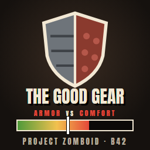

# The Good Gear (TGG): Armor vs Comfort

*Fight to live. Dress to fight.*

A **Project Zomboid Build 42** mod: a small window that shows what your gear really costs you in **discomfort**, and what it gives you back in **protection**.

> **Steam Workshop:** coming soon. This page will link to it once the mod is published.
> **Translations:** this mod speaks 24 languages, and most of them need a native speaker's eye. [You can help in five minutes.](#help-with-the-translations)

---

## Why

Build 42 made discomfort a real trade-off: every vest, helmet and backpack makes your survivor uncomfortable, and an uncomfortable survivor gets stressed. The game shows a moodle and a tiny bar per item. It never shows the total, where it is heading, or what each piece of gear gives you back in protection.

**The Good Gear** does.

## What it shows

- **Your discomfort**, in %, with the moodle steps (20, 40, 60, 80).
- **Where it is heading**, with two markers on the bar:
  - **yellow**: where your clothing alone takes it;
  - **red**: the max with environment, with your surroundings on top (wet, cold, heat, a bad bed or the floor, dragging a corpse, an overloaded vehicle; alcohol lowers it).
  Discomfort climbs slowly up to it, and drops fast when you take things off.
- **Stress and unhappiness**, what discomfort leads to: their value in % and the game's moodles on a 4-step scale. The more stressed you are, the worse your aim becomes.
- **Your protection score**, out of 100 %: your average bite and scratch protection over the 17 body parts, the same values as the game's Protection tab.
- **Speed penalties** of your gear: movement and attack speed, in %.
- **Every worn item**, grouped by body region (head, neck, top: torso, arms and hands; bottom: groin, legs, feet; bags; bandages last): its discomfort points and its bite and scratch protection, **patches included**, part by part, like the game's garment window.
- **Holes**: a danger icon on damaged items, with a tooltip (and a clear warning when the item can't be repaired).
- **Two foldable sections**: clothing discomfort and environmental and situational discomfort, each cause led by the game's own moodle icon.
- **Improvable column**: a check per item tells whether its padding is at the best your current tailoring level allows, can be improved, is partial, is missing, or can't be done at all (tooltip on hover); your tailoring level is shown too.
- **Covered body parts**: hover an item's icon to see exactly which body parts it covers.
- A **discreet panel** in the style of the game's own windows, for when you just want the numbers.

Find the gear that protects the most for the fewest points.

## How to use it

- Press **Insert**, or right-click a clothing item or a bag and pick *The Good Gear (TGG)*.
- Hover the **?** for a plain explanation of the formula.
- The small window button next to the cross switches to the discreet panel.
- Drag the window anywhere: it reopens where you left it.

## Options

*Options › Mods › The Good Gear*

| Option | Default |
|---|---|
| Key to open and close the window | Insert |
| Refresh interval (1 to 60 s) | 1 s. A short interval recalculates more often and can affect the game's performance: set it with care. Nothing is calculated while the window is closed. |
| Window size | Medium (or compact) |
| Game names for renamed items | On |
| Maximum height (% of the screen) | 50 % |
| Show items without discomfort | On |
| Show the explanation (?) | On |
| Show environmental discomfort | On |
| Green protection values | On |

## How the numbers are computed

Read from the game itself (Build 42.22): discomfort heads for the sum of the worn items, plus 10 per level of Wet, Hypothermia and Hyperthermia, plus 30 to 50 for a bad bed or the floor, 30 for dragging a corpse, 25 per Heavy Load level in a vehicle, times 1 to 0.5 for alcohol, capped at 100. Desensitized survivors ignore gear discomfort.

## Good to know

- **Read-only**: it changes nothing in your game and writes no file. Safe to add or remove from an existing save.
- **Client side**: works in single player and multiplayer (it only reads your own character).
- **Tested on Build 42.22 only.** Older 42.x builds are not supported: some values may be missing there. Every game call is protected, so on another build the window shows less instead of breaking your game. If something looks wrong on your build, [open an issue](../../issues) and tell us which one.
- **Competitive runs** (ranked challenges that forbid mods): don't enable it there.

## Help with the translations

The mod is in **24 languages**. Only **English** and **French** have been checked by a native speaker; the others reuse the game's own terms where possible, but they deserve a proper review.

| Status | Languages |
|---|---|
| Checked | English, Français |
| **Needs a native speaker** | Deutsch, Español, Português (Brasil), Português, Русский, Українська, Polski, Čeština, Magyar, Română, Nederlands, Dansk, Norsk, Suomi, Català, Italiano, Türkçe, Bahasa Indonesia, 简体中文, 繁體中文, 한국어, 日本語 |

**Three ways to help:**

1. **Fix a translation**: open [`translations/<LANGUAGE>/IG_UI.json`](translations), find what reads wrong, and [open a "Translation fix" issue](../../issues/new?template=translation-fix.md) (or a pull request on that file).
2. **Add a new language**: copy [`translations/EN/IG_UI.json`](translations/EN/IG_UI.json), translate the values, and [open a "New language" issue](../../issues/new?template=new-language.md) with your file.
3. **Just tell us**: a word that sounds odd in the game, a text that doesn't fit its box, anything. An issue is enough.

Before you start, read [TRANSLATING.md](TRANSLATING.md): it explains the few rules that keep the game from crashing on a text (the `%1` placeholders, and why a lone `%` is forbidden). Accepted translations ship with the next update of the mod, with credit in the changelog.

## Changelog

- **1.1.1**: two markers on the bar (clothing, max with environment) with their legend; clothing and environmental discomfort sections; moodle icons; protection with patches and holes; danger icon on damaged items; items grouped by body region, bandages last; worn bandages shown as the real bandage; green protection values (option); a visible warning on the refresh interval; the large window size removed; Improvable column (padding state, tailoring level); covered body parts on hover; upper body / lower body regions; the window follows the game's font size (1440p, 4K) and every translation fits, checked in all 24 languages at every font size.
- **1.1.0**: discreet panel, 12 more languages (24 in all), refresh interval of 1 s at least.
- **1.0.0**: first release.

The full Steam description is in [steam-description.bbcode.txt](steam-description.bbcode.txt).

---

### En français

Un mod **Project Zomboid (Build 42)** : une petite fenêtre (touche **Inser**, ou clic droit sur un vêtement) qui montre votre inconfort sur 100, jusqu'où vos vêtements le font monter (repère jaune) et la limite totale avec l'environnement (repère rouge), votre protection sur 100 % (morsures et égratignures, renforts compris), les pénalités de vitesse, et chaque objet porté avec son inconfort et sa protection. **Vous parlez une autre langue que le français ou l'anglais ?** Les traductions sont dans [`translations/`](translations) : toute relecture est bienvenue, par une issue ou une pull request.

---

Made by **maaltar**, streamer of *The Story of Anton Noreaga* on [twitch.tv/maaltar](https://www.twitch.tv/maaltar).
If the mod helps you, you can [buy me a coffee](https://buymeacoffee.com/maaltar_twitch) ☕. Project Zomboid © The Indie Stone. This is an unofficial fan mod, not affiliated with or endorsed by The Indie Stone.
